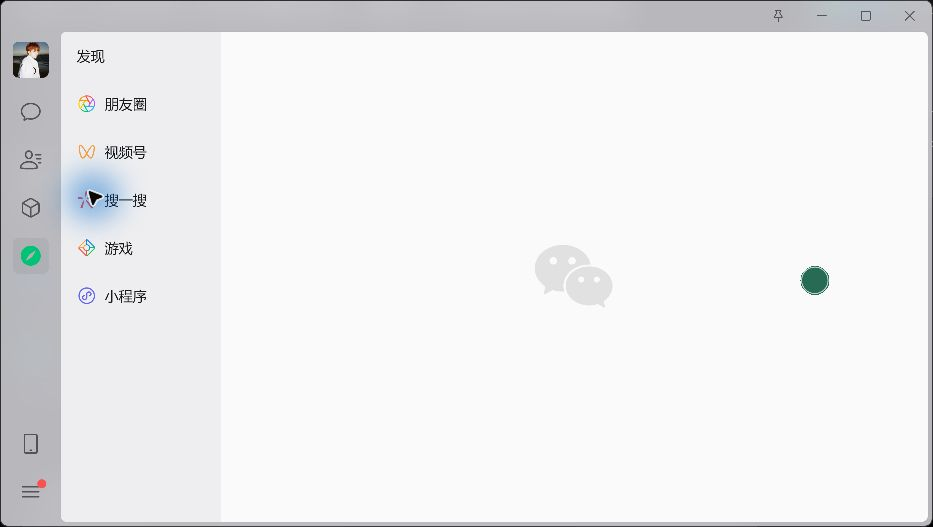
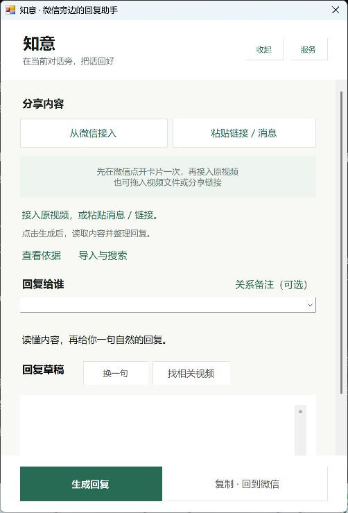
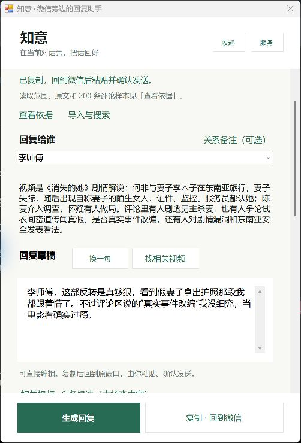
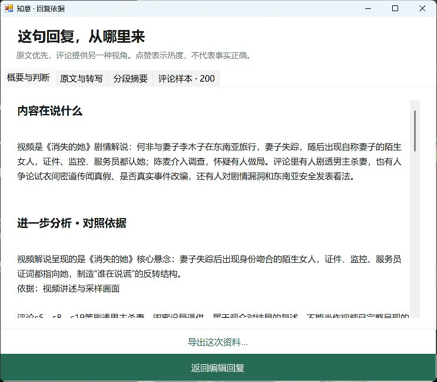
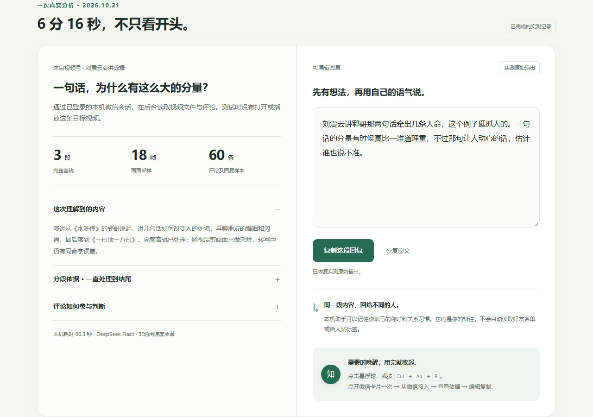
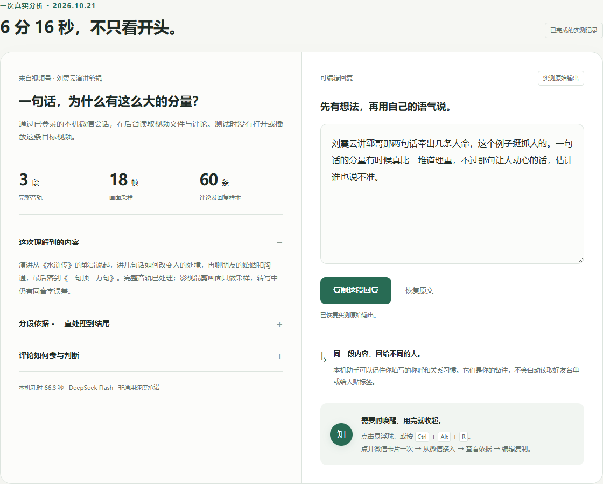
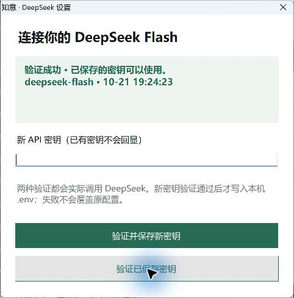

<div align="center">

# 知意

### 先读懂分享，再好好回一句。

微信旁边的本机回复助手 · 原视频与评论一起理解 · 依据可核对 · 回复由你决定

[**在线演示**](https://mtmt0111.github.io/xingyu/) · [**免安装 Demo**](https://github.com/MTMT0111/xingyu/releases/latest/download/zhiyi-offline-demo.zip) · [**Windows 完整体验**](https://github.com/MTMT0111/xingyu/releases/latest) · [**使用指南**](distribution/windows/START-HERE.md) · [**参与共创**](#一起完善知意)

</div>

---

爸妈发来一段养生视频，朋友分享一篇长文章。你想认真回应，又没有时间逐条看完；只回一个“收到”，总觉得少了点什么。

知意把**内容说了什么、评论有哪些不同意见、该怎样回应这个人**整理到一个小窗口里。需要时点开悬浮球，用完收起。它帮助你形成自己的回应，不替你判断关系，也不替你发送消息。

> **只记住一个仓库：[MTMT0111/xingyu](https://github.com/MTMT0111/xingyu)。** 客户端、后端、演示网页、安装脚本和文档都在这里；安装包在本仓库 Releases。`xingyu` 是历史工程名，现在产品叫“知意”。

## 先看效果

### 真实微信旁的悬浮入口



*2026-10-22 实机截图：微信旁只保留一个绿色悬浮球，需要时点开。为避免展示私人聊天，截图停在“发现”页。*



*同日实际运行的客户端初始窗口，非合成演示。保持绿色与暖白配色，增加区块留白；关系备注、导入与搜索、服务设置按需展开。窗口收起后，再次打开 EXE 也能唤起原窗口，保留已有草稿。*

<details>
<summary>展开看实机结果：20 分 25 秒视频的回复与依据</summary>





2026-10-22，实际接入“未知说电影”的《消失的她》解说，处理约 20 分 25 秒的完整音轨：7 段、42 帧、200 条评论与回复样本，并取得 6 条相关视频候选。用户修改回复对象、换一句并复制返回微信，截图保留实际结果。平台报告的评论总数为 1,523，本次没有读完整个评论区。

截图中的 6.2 秒来自资料缓存复用，不能当作首次视频处理速度；首次完整耗时本轮未准确留存。详见 [提交版验收记录](docs/提交版验收.md)。

</details>

| 你想做什么 | 从这里开始 |
| --- | --- |
| 给评委、朋友快速看效果 | [稳定演示页](https://mtmt0111.github.io/xingyu/)：真实运行记录、编辑与复制；[文字示例](https://mtmt0111.github.io/xingyu/text-demo.html)使用本地规则 |
| 下载后直接打开，不配置环境 | [免安装 Demo ZIP](https://github.com/MTMT0111/xingyu/releases/latest/download/zhiyi-offline-demo.zip)：完整解压，双击 `START-DEMO.html`，离线看记录或试文字规则 |
| 分析自己的视频、文章和消息 | [Windows 安装包](https://github.com/MTMT0111/xingyu/releases/latest)：使用自己的模型密钥；视频号读取使用自己的微信会话 |
| 一起改代码、提问题 | 克隆本仓库；在 [Issues](https://github.com/MTMT0111/xingyu/issues) 反馈，在 [Pull requests](https://github.com/MTMT0111/xingyu/pulls) 提交修改 |

<details>
<summary>展开查看：稳定网页里的真实分析记录</summary>

<a href="https://mtmt0111.github.io/xingyu/"></a>



这两张是展示页截图，呈现已完成的真实分析记录，可编辑和复制。网页本身不执行实时 AI；分析自己的内容，请使用完整本机程序。真实本机链路的验收细节见下文。

</details>

## 在微信旁边，四步完成

**打开原卡片一次 → 从微信接入 → 看依据、改回复 → 复制回微信。**

1. 在电脑版微信打开“视频号”，保持会话在线。点开聊天里要分析的原卡片一次，让本机连接器获得原视频标识；不用看完整段视频。
2. 点击悬浮球，或按 **Ctrl + Alt + R** 唤起知意。点“从微信接入”（快捷键 **Ctrl + Alt + V**），核对标题、作者和时间，选择原视频。
3. 填写回复对象；需要时展开“关系备注”，例如“妈妈，平时说话简短自然”。点“生成回复”，后台读取视频、转写完整音轨、采样画面并整理实际返回的评论。
4. 展开“查看依据”，核对转写、分段摘要、评论原文和点赞数；修改回复后点“复制 · 回到微信”，由你核对聊天对象并粘贴发送。

公众号文章可粘贴公开原文链接；普通消息可粘贴文字；本地视频文件和可复制的分享链接可拖入。**微信私有视频号卡片本身不能当文件拖出**，请用上面的“从微信接入”。

### 免安装，先试一遍

下载 [zhiyi-offline-demo.zip](https://github.com/MTMT0111/xingyu/releases/latest/download/zhiyi-offline-demo.zip)，**完整解压后双击 `START-DEMO.html`**。无需 Node.js、Python、密钥或微信连接器，浏览器即可离线打开：查看已完成的视频分析记录、展开依据、编辑复制回复，也可以试文字规则。

这个包用于展示与交互体验，不会读取自己的微信或实时调用 AI。想分析自己的内容，使用下面的完整本机包；两种入口都在同一个 Release。

### 完整本机功能，第一次配置

1. 从 [本仓库 Releases](https://github.com/MTMT0111/xingyu/releases/latest) 下载并完整解压 `zhiyi-windows-local.zip`。
2. 安装 Node.js 22+；视频分析另需 Python 3.11 / 3.12。运行 `setup.cmd`，按提示配置依赖和语音模型。
3. 运行 `start-local.cmd`。悬浮窗中打开 **服务 → DeepSeek 密钥 · 配置 / 更换**，填写自己的密钥后点“验证并保存新密钥”。
4. 要读取视频号与评论，再下载同一 Release 的 `zhiyi-wechat-connector.zip`，把 `connector` 文件夹放入本机包，运行 `enable-wechat.cmd`。它会说明 SunnyRoot 证书和本机代理的变更，由设备本人确认后启用。



*真实窗口截图：只有模型请求验证通过，才显示绿色成功提示。新密钥还须成功写入本机 .env；已有密钥可单独验证。*

完整步骤、升级、退出与常见问题见 **[本机使用指南](distribution/windows/START-HERE.md)**。没有密钥也能打开文字示例；模型调用按所用平台计费。密钥不写入客户端、不上传到 GitHub。

## 为什么值得做

- **回应有内容。** 先知道视频讲了什么，再给出与内容相关的一句话，减少空泛的“谢谢分享”。
- **依据看得见。** 音轨转写、分段摘要、评论及实际点赞数可以逐项核对；评论热度不等于观点正确。
- **语气由关系决定。** 使用你自己填写的称呼与沟通习惯，生成后还能改；不必先选择一长串“回复风格”。
- **留在当前工作场景。** 悬浮入口随用随开，资料与草稿放在同一处；不要求频繁在多个网页间切换。

## 真实试用反馈，如何改进

以下来自本项目试用过程的问题记录，不是用户评分或推广评价。

| 试用中遇到的问题 | 已做的改进 | 怎么核对 |
| --- | --- | --- |
| “拖不进微信视频卡片，还得自己输入关键词” | 通过本机会话接入原视频，核对后选择；拖入保留给真实文件和可复制链接 | [原视频接入验收](docs/微信卡片选取验收.md) |
| “分析很慢，换一句又重新等” | 展示处理阶段；完整视频资料在服务进程内复用 10 分钟，换一句只重新生成 | [速度与分析验收](docs/速度与分析验收.md) |
| “评论太少，看不出依据” | 分页读取最多 200 条评论及回复样本；转写、摘要、评论分栏，保留来源编号与点赞数 | [长视频与交付验收](docs/长视频与交付验收.md) |
| “AI 返回不完整，保留的文字找不到” | 格式失败自动修复一次；仍失败可点“查看已读资料”并导出，保留已有草稿 | [失败恢复验收](docs/失败恢复与密钥验收.md) |
| “密钥到底有没有保存、验证成功” | 分开验证已有密钥与保存新密钥，显示模型和时间；区分网络、认证、余额、保存错误 | [密钥验证记录](docs/失败恢复与密钥验收.md) |
| “窗口太拥挤，再打开程序找不到窗口” | 增加区块留白，收起关系备注和其他导入方式；再次打开 EXE 唤起已有窗口并保留草稿 | 本页 10 月 22 日实机截图；Windows 构建、自检及再次启动验证 |

### 已完成的实际测试

截至 **2026-10-22**，Windows 本机与已登录的真实微信会话已走通原视频读取、评论、DeepSeek 生成、依据查看与复制流程。本轮重新执行 **95 项 Node 测试，全部通过**；Windows 最终构建与自检通过，再次打开 EXE 成功唤起原窗口。以下视频数据来自此前保留的真实运行记录：

| 视频实测 | 实际取得的资料 | 该次耗时 |
| --- | --- | --- |
| 约 24 秒视频 | 原视频及 5 条评论样本 | 首次 19.6 秒；复用资料换一句 4.9 秒 |
| 9 分 53 秒视频 | 4 段完整音轨、2,305 字转写、52 条评论及回复 | 首次 96.6 秒；复用资料换一句 4.4 秒 |
| 7 分 53 秒视频 | 3 段音轨、200 条评论及回复样本、依据分析 | 首次 84.4 秒；另一次遇到格式修复，总计 89.1 秒 |
| 20 分 25 秒电影解说（10 月 22 日） | 完整音轨 7 段、42 帧、200 条评论及回复样本、6 条相关候选；实际编辑、复制返回微信 | 首次未准确留存；复用资料换一句 6.2 秒 |

这些是特定电脑、网络和视频的运行记录，不是所有设备的速度承诺。评论数量表示实际样本，不表示读完评论区；相关候选尚未分析。[本轮完整验收记录](docs/提交版验收.md) 还包含窗口唤起、页面宽度与离线包检查。

## 能力与边界

| 部分 | 当前情况 |
| --- | --- |
| Windows 悬浮助手 + 本机后端 | 当前主要交付；真实微信视频号、公开文章、文本与本地媒体分析 |
| 评论与相关视频 | 评论样本最多 200 条；相关视频为真实搜索候选，尚未分析，不能当作已核实的依据 |
| 视频长度 | 按每 3 分钟分段处理完整音轨、每段采样 6 帧；文件上限 512 MiB / 4K，处理时限 90 分钟；受权限、编码和证据容量影响 |
| 联系人与发送 | 记住自己填写的关系备注；不自动枚举微信好友，不自动发送回复 |
| 网页 / 免安装 Demo | 静态展示与文字规则体验；解压包双击即可离线使用，不连接访客微信、不提供共享 AI 密钥 |
| Android / iOS / 微信小程序 | 源码保留供继续开发；手机实体设备与发布链路尚未完成验收，不等同于 Windows 已验证能力 |
| Jev / Kiro | Jev 可选但未配置验收。Kiro 在 10 月 22 日重试仍返回账号锁定，实际模型任务尚未完成；已有配置不等于满足参赛要求，详见 [提交清单](SUBMISSION.md) |

知意是第三方本机伴随应用，**不是微信官方插件**。微信升级、会话失效或内容权限可能影响连接器。音频转写在本机进行；点击生成后，选中内容、画面样本、转写、评论与关系备注会发送到你配置的模型服务。需要留存的依据请主动导出，进程内缓存不会永久保存。

## 一起完善知意

**所有改动都提交到这个仓库，无需再克隆一个 Demo 仓库。** 共创者获得仓库权限后即可取完整代码；演示页只发布 `site/`，本机包由白名单脚本生成。

```powershell
git clone https://github.com/MTMT0111/xingyu.git
cd xingyu
npm ci
# 仅首次配置；已有 .env 时保留原文件
if (!(Test-Path .env)) { Copy-Item .env.example .env }
# 编辑 .env 填写自己的模型配置
npm start
```

后端默认在 `http://127.0.0.1:4173`。编译 Windows 客户端执行 `./clients/windows/build.ps1`；视频依赖见 [MEDIA.md](MEDIA.md)。不要提交 `.env`、微信会话、聊天记录或带密钥的日志。

```text
xingyu/
├─ clients/windows/        Windows 悬浮助手（主要客户端）
├─ server.mjs + lib/       模型调用、文章/视频/评论处理
├─ public/                 本机网页界面与静态资源
├─ site/                   同仓库的公开展示页与文字示例
├─ distribution/windows/  本机安装、启动、停止与说明
├─ integrations/           微信连接器接入与来源说明
├─ clients/                Android、iOS、小程序后续工程
├─ tests/ + scripts/       测试、构建、打包与验收脚本
├─ docs/ + screenshots/   使用、验收和截图
└─ .kiro/                  需求规格、任务与开发约定
```

验证：`npm test`；Windows：`./clients/windows/build.ps1`；打包：`./scripts/package-windows.ps1`。演示网站由 `.github/workflows/pages.yml` 从 `site/` 发布，源码提交、演示源码和 Releases 都以本仓库为准。

欢迎优先一起改进：微信升级后的接入兼容性、更多真实长视频与评论场景、第二台 Windows 与实体安卓验收、自然回复质量。反馈请附**操作步骤、预期、实际提示、系统和微信版本**；截图先遮去私人聊天与账号信息。可以直接 [提交问题](https://github.com/MTMT0111/xingyu/issues/new)。

进一步阅读：[比赛材料](SUBMISSION.md) · [Windows 开发](clients/windows/README.md) · [素材与字体来源](ASSETS.md) · [连接器说明](integrations/wx-channel/README.md) · [仓库与交付说明](docs/仓库与交付.md)
