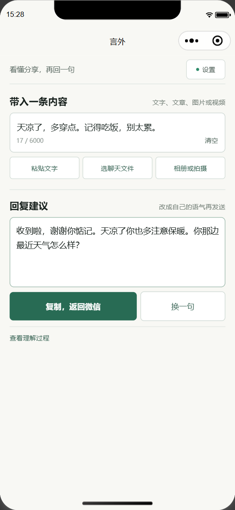

# 言外 · 微信聊天回复助手

面向父母长辈分享场景的微信小程序、网页和 Android 聊天键盘。小程序负责文字、文章、图片与视频分析；Android 可在当前聊天输入框调用回复键盘，把确认过的回复直接插入输入框。小程序 AppID 已配置，真机使用仍需 HTTPS 合法域名、隐私指引和验收。产品范围见 `PRODUCT.md`，比赛要求见 `COMPETITION-REVIEW.md`。

正式发布后，微信用户可以收藏小程序或添加到“我的小程序”，也可把同一首页卡片发到文件传输助手作为固定入口；不需要另建产品账号。微信平台不向普通小程序开放私人聊天读取、好友列表选择或自动代发，因此实际闭环仍是主动放入内容、生成回复、复制返回聊天并确认发送。

<p align="center"></p>

快速入口：[点击体验公开 Demo](https://mtmt0111.github.io/haohaohui-demo/) · [微信小程序工程](clients/wechat-miniprogram) · [安卓开发版 APK](downloads/xingyu-android-debug.apk) · [验证记录](QA.md) · [比赛提交清单](SUBMISSION.md)

## 克隆后运行

当前本地演示方案见 [本地部署与安卓演示](docs/本地部署与安卓演示.md)：本地网页与服务端调用云端 LLM，安卓优先使用 USB 真机，Android Studio 内置镜像仅作可选方案；不安装额外插件。

需要 Node.js 22 或更新版本。在终端运行：

```sh
git clone https://github.com/MTMT0111/xingyu.git
cd xingyu
npm ci
npm start
```

打开 http://127.0.0.1:4173。新克隆不含任何服务密钥，默认运行本地示例。需要真实 AI 时，复制 `.env.example` 为 `.env`，填写自己的 LLM 配置并重启；TypeSafe/Jev 是可选分类器，不再是启用 AI 的前提。不要提交 `.env`。视频运行环境见 [MEDIA.md](MEDIA.md)。

下方配置状态和随仓库保存的测试报告记录原开发电脑的历史结果，不代表新克隆已配置密钥、连接模型、部署公网或通过真机测试。

## 当前开发环境（2026-10-17）

- 本地 `127.0.0.1:4173` 已启动，配置接口确认真实文字、图片和视频入口均启用，当前为 LLM 独立模式。
- 仅配置 LLM 即可分析并生成回复；配置 `TYPESAFE_API_KEY` 后才增加 Jev 分类。仓库不含真实密钥。
- 默认入口已改为 430px 内的插件工作台，不再展示网站首页、导览或页脚；打开即完成“放入内容 → 读懂重点 → 编辑发送”。可选择认真聊聊、简短自然或温和有边界。当前标签页会暂存原文、对象、回复方式与编辑稿，附件不保存，恢复后需重新选择。
- 原生微信小程序工程 `clients/wechat-miniprogram` 已配置 AppID `wx44641c021b958fdd`：手机未配置服务时可离线完成文字分析、编辑和复制；连接已登记的 HTTPS 服务后再启用真实 AI、图片和视频。页面不使用 `web-view` 或第三方插件。2026-10-17 已上传 `0.8.0` 开发版本（41,838 字节），并声明微信聊天视频素材入口。仍缺固定 HTTPS 合法域名、隐私指引、平台审核和实体真机记录，不能称为已经发布。
- Android Debug 增加“USB 本地调试”，通过 `adb reverse` 访问固定 `http://127.0.0.1:4173`；Release 仍只接受 HTTPS。无需额外 Studio 插件。
- Android 已实现系统分享、选中文字与“言外 · 回复键盘”。在微信输入框切换到该键盘后，可主动分析已复制的消息；生成并确认后返回微信，再点“插入回复”写入当前输入框。另有明确征得同意后才能启用的实验悬浮球：它使用系统无障碍服务，只在微信前台显示；Android 11 以上仅在用户单击时截取一次当前可见屏幕并读取可访问文字，低版本只读取可访问文字。普通入口不监听聊天或后台剪贴板，也不申请存储、联系人或传统悬浮窗权限。
- Android WebView 固定使用 `?host=android` 插件模式，与默认入口共用紧凑工作台，并隐藏草稿、示例等次要操作。原生“发送”使用 Android `ACTION_SEND` 打开系统分享面板，没有微信 AppID 时仍可使用；不会自动选择联系人或确认送达。
- 2026-10-18 工程测试 63/63 通过；Android Debug/Release 各 16 个单元测试和 lint 通过，Debug APK v2 签名有效。2026-10-17 的 MEmu 微信登录页记录覆盖此前的文字版悬浮球；本次新增的 Android 11+ 单次截屏入口尚未连接设备实测，详情见 [运行记录](clients/android/wechat-bubble-test-results.json)。
- Lenovo/MEmu Android 9（API 28，Chrome/WebView 68.0.3440.70）已验证当前版 `ACTION_SEND` 文字一次确认后自动调用真实 DeepSeek 并生成回复；原生“复制返回”写入剪贴板并结束页面，随后 `QUICK_REPLY` 读回了同一句话。快捷设置磁贴成功添加并点击，能打开剪贴板确认；静态快捷方式 `clipboard_reply` 已在系统注册。
- 原生“发送”成功打开 Android `ChooserActivity`，但模拟器没有可接收的 App，因此未验证实际交付。文件管理器真实分享 `parent-message.mp4`（11.4 秒、约 0.16 MB）成功进入言外，一次确认后约 30 秒完成真实视频画面、语音分析并生成回复；系统分享、`ACTION_PROCESS_TEXT` 及图片/视频入口仍正常。
- WebView 68 兼容修复和 `?host=android` 紧凑页随当前版运行。当前悬浮球实测覆盖官方微信登录页的可见文字，没有登录微信账号；实体安卓手机、已登录聊天、视频号素材、Android Studio AVD、iOS 及 Jev 仍未验收。小程序 AppID 和开发者工具预览已通过，但不能等同于微信真机完成回复闭环。

## 历史验证与未完成边界

用户已确认所提供密钥属于 **DeepSeek**。密钥仅用于服务端配置，不写进本 README、网页、客户端或交付压缩包。当前优先搭建免费试用环境；域名购买、付费认证与 iOS 分发留到后续。

- 网页、分析接口、编辑复制与双端微信桥接已实现。2026-10-17 `npm test` 为 63/63 通过，其中小程序专项 14 项。
- 公开可玩 Demo 已部署到 [GitHub Pages](https://mtmt0111.github.io/haohaohui-demo/)；它只运行本地规则和人工文案，不上传内容、不调用 DeepSeek，也不开放图片/视频。完整真实 AI 仍由本机服务验证，不能把静态 Demo 写成公网 AI 服务。
- 2026-10-18 含回复键盘和单击截屏悬浮球的 Android Debug 构建、Debug/Release 各 16 个单元测试、lint 与 APK v2 签名校验通过。最新下载包为 1,368,219 字节，SHA-256 `cf2bf269fb16eb8cd3db27a1c8f2efe2ad29f59c0ead025a7186164636b83ed3`。此前文字版已完成 MEmu 微信登录页闭环；本次截屏版未连接设备，iOS 仍为源码，尚未在 Mac 编译。
- DeepSeek 已配置官方服务 `https://api.deepseek.com` 的 `deepseek-flash`。2026-10-17 两次真实合成样本调用（文字、图片）均 HTTP 200 并通过结构校验；本机 `/api/reply` 也实际生成了一条长辈关心回复。详见 `deepseek-test-results.json`；这只验证了 DeepSeek，不代表 Jev 或完整手机链路已通过。
- TypeSafe/Jev 账户已由用户创建，但仍未配置 Jev 密钥。旧版曾因此禁用真实生成；现在 LLM 可独立运行，Jev 分支仍需单独验收，不能将 LLM 成功称为 Jev 已接通。
- 用户已在微信开放平台确认当前个人主体不能创建移动应用。SDK 工程保留，但直接选微信联系人仍需要合格主体的移动应用 AppID 及匹配包名/签名。Android 系统分享接收另走系统标准入口，不受这个 AppID 前提限制。
- 本地 AI 服务当前运行于 `http://127.0.0.1:4173`。临时 Quick Tunnel 提供自动登录直达链接，并保留 Basic 访问保护；地址随进程变化，不写入仓库，也不能替代小程序需要登记的固定 HTTPS 合法域名。公开 Pages Demo 仍是纯前端离线体验。
- 已完成 11 项本机访问保护检查：缺少口令返回 401、正确认证可访问、私有文件返回 404、错误 Host/Origin 返回 403。测试没有调用模型，测试端口已关闭；这不代表公网 TLS 或手机微信已验证。

### 免费手机试用启动入口

仓库提供 [start-free-trial.ps1](scripts/start-free-trial.ps1) 和 [手机试用说明](docs/手机试用说明.md)。先执行 `npm ci`，再从仓库根目录的 Windows PowerShell 手动运行：

```powershell
& '.\scripts\start-free-trial.ps1'
```

脚本会准备临时 HTTPS 直达链接和独立试用口令；请以实际成功输出为准。浏览器直接打开直达链接即可自动登录，Android 客户端仍填写不含 `?access=...` 的 HTTPS 根地址和口令，而不是 `127.0.0.1`。电脑、服务与隧道需保持运行；电脑休眠、关机或网络变化可能使试用中断。结束时从同一目录运行：

```powershell
& '.\scripts\start-free-trial.ps1' -Stop
```

脚本已通过 PowerShell 5.1 语法检查，并完成临时域名、自动登录、Cookie、HTTPS 保护和私有路径的公网验证。它不购买任何服务；未配置 LLM 时仍是本地示例，开通隧道不会自动补齐模型能力。USB 安卓演示不需要公网隧道。

## 现在如何登录与申请

### TypeSafe / Jev

用户已完成 [TypeSafe 官方控制台](https://console.typesafe.ai/) 账户创建。先按 [Jev 中文上手指南](docs/Jev中文上手指南.md) 理解 Playground、State、Questions、Choice、Noul、Score 与概率，再在 API Key 管理入口创建项目密钥并配置到服务端 `TYPESAFE_API_KEY`。账户创建不等于密钥已配置。这是独立于 DeepSeek 的服务，不能使用 DeepSeek 密钥代替。[官方接口说明](https://docs.typesafe.ai/api)

先查看账号是否有试用额度；如提示充值或绑定付款方式，暂不办理，保留为待办。免费部署不等于模型调用免费，DeepSeek 与 Jev 各自按账号额度及用量计费，不能承诺新注册账号一定有免费额度。

### 当前个人主体的微信路径

2026-10-10，用户登录 [微信开放平台](https://open.weixin.qq.com/) 后确认当前个人主体不能创建移动应用。前面的通用申请指引没有先验证主体资格，已更正。当前不要求用户反复尝试申请、不虚填主体、不购买账号或借用他人 AppID。SDK 源码留作未来具备资格后的可选方案；对应包名和签名见 `CLIENTS.md`。

安卓安装新版客户端后，在 App 设置中启用“言外 · 回复键盘”，再在微信输入框切换到它。复制对方消息，点“分析剪贴板”；生成后点“复制返回”，回到同一聊天点“插入回复”，检查后由用户发送。系统分享、选中文字、原生粘贴、启动器快捷方式和快捷设置磁贴仍可使用。键盘不读取聊天记录或联系人，也不会自动点击发送。

Android `ACTION_SEND` 和 `ACTION_PROCESS_TEXT` 是进入言外的入口；网页“系统分享”是把回复交给其他应用，两个方向不同。微信是否提供系统菜单及支持的媒体，依微信版本与 ROM 而定；没有入口时继续复制文字或保存媒体后选文件。iOS Share Extension 与网页分享目标尚未实现。若分享的是 `127.0.0.1:4173` 页面链接，另一台设备不能直接访问电脑的本机地址；USB 调试需先设置 `adb reverse`。

用户此前报告网页分享失败；具体设备、方向、操作按钮及错误原文仍待确认。已检查到系统分享的 `AbortError` 也可能表示没有分享对象，不能一律归因于用户取消；对应提示已纳入修正。MEmu 上的 Android 入站分享现已通过，但不能代替用户设备上的微信分享复现。分享失败保留草稿，不自动发送或改为分享网页链接。

## 未完成事项

- [x] DeepSeek 真实文字与合成图片请求通过，响应经结构校验；报告为 `deepseek-test-results.json`。
- [x] 2026-10-14 曾用 7 个非私人合成样例通过真实 LLM 网页闭环，包含健康说法与未知内容检查（历史记录在 Git 中）。2026-10-17 当前克隆缺少 Playwright，`npm run test:live` 在发出模型请求前明确标记为环境阻塞；没有安装浏览器依赖。
- [x] 2026-10-17 本地视频真实解码与 Whisper 转写、取消及文件清理通过，视觉/决策/回复模型为测试替身；详见 `local-video-test-results.json`。
- [ ] 扩大中文语义、健康回复与真实用户媒体的人工复核，不把合成样例和规则检查推广为普遍准确率。
- [ ] 取得 TypeSafe/Jev 有效密钥，验证话题判断和健康断言分支，再完成 `npm run test:live` 的完整真实调用；Jev 降级结果不能算 Jev 接入通过。
- [x] 部署无需登录、点击即玩的公开文字 Demo，并核验首页、脚本、样式和字体均返回 HTTP 200；地址为 `https://mtmt0111.github.io/haohaohui-demo/`。
- [ ] 取得可供小程序调用的 HTTPS 后端并核验口令保护与完整模型调用。公开静态 Demo 不承担这一能力；后续稳定部署、固定域名、持久化额度与运维仍未完成。
- [x] 用户已创建 TypeSafe/Jev 账户；API Key 配置和真实调用仍是独立待办。
- [ ] 解决用户设备上的网页分享失败：先确认方向、设备、错误；MEmu 入站分享通过和系统分享提示改正不能代替真实微信复现。
- [x] 在 Lenovo/MEmu Android 9 验证 `ACTION_SEND` 文字/图片/视频、`ACTION_PROCESS_TEXT`、真实 DeepSeek 生成、旧 WebView 复制降级及返回来源图库；报告为 `clients/android/usb-demo-test-results.json`。
- [x] 2026-10-14 在 MEmu Android 9 验证当前插件版：`ACTION_SEND` 文字一次确认后真实 DeepSeek 生成，“复制返回”写入原文，快捷磁贴读回原文并消费一次性令牌，无令牌重放未读取剪贴板，静态快捷方式已注册；此前的 Chooser、图片和 11.4 秒视频结果保留在设备报告中。
- [x] 2026-10-17 在 MEmu 安装官方微信 8.0.79，按真实系统流程开启无障碍服务；当时的文字版悬浮球仅在微信前台出现，点击后读取登录页可见文字，经确认调用 DeepSeek，生成并“复制返回”到微信。2026-10-18 的单次截屏版、已登录聊天与微信视频仍待实体设备验证。
- [ ] 在实体安卓手机验证上述插件入口、系统分享、草稿冲突与临时 URI 授权失效，并记录微信版本与 ROM 是否展示入口；模拟器通过不代表实体微信验收。
- [ ] 当前个人主体无法创建移动应用，SDK 的 AppID 路线受资格阻碍。本阶段不继续申请；只有后续具备合法资格再评估平台登记与签名。
- [ ] Android 手机上完成「真实生成 → 编辑 → 复制 → 微信粘贴发送」，覆盖相册/视频选择、复制失败及返回保稿。直接 SDK 选人验收须等待主体/AppID 条件成立。
- [x] 原生微信小程序源码、离线文字闭环、连接设置、会话文件/相册/剪贴板入口、聊天视频素材入口、结果编辑复制、收藏分享、AppID 配置和 14 项专项测试已完成；2026-10-17 已推送预览，并上传为 `0.8.0` 开发版本（41,838 字节）。
- [ ] 部署 HTTPS 服务，配置 `request` 合法域名与隐私保护指引；在 Android/iPhone 微信完成真实 LLM 闭环后再提交审核。
- [ ] iPhone 微信网页验证口令登录、中文键盘、字体、媒体选择、复制与系统分享；桌面浏览器模拟不代替真机。
- [ ] iOS 在 Mac 上生成工程、安装 Pods、编译并执行 XCTest，完成签名及 Universal Links / AASA 回调。基础个人设备测试可先评估 Apple 免费 Personal Team，但本项目的 Associated Domains 能力、签名和微信回调仍需核实，不能据此保证完整接入免费。发行/TestFlight 后续再讨论。[Apple 账号说明](https://developer.apple.com/help/account/basics/about-your-developer-account)
- [x] 2026-10-14 合成图片与有声视频曾通过真实网页 → 本地处理 → 云视觉 → LLM 回复 → 编辑复制；本地 ASR 与云调用均未模拟。2026-10-17 本机复测真实 DeepSeek 文字/图片及实际文字回复接口通过，视频 ASR 通过但云模型使用测试替身。MEmu 的系统入站分享也已通过；本轮未连接实体手机，Jev 分支仍未配置。
- [ ] 用实际可读的公众号正文完成抓取验收。之前两个真实链接均被微信验证码拦截；遇到限制先复制正文或上传截图，不绕过验证。
- [ ] 恢复 Kiro 账号并完成真实 spec / 开发或审阅记录。现有调用返回 `TEMPORARILY_SUSPENDED`（HTTP 403），比赛要求的真实 Kiro 参与尚未满足。
- [x] 已整理 [比赛提交清单](SUBMISSION.md)、50 字内一句话、200 字内事实版说明，并生成 4 分 22 秒、1280×720 的带字幕预检视频及小于 200 MB 的 ZIP。
- [ ] Kiro 恢复后补入真实 prompt、输出、差异与测试片段，再生成最终提交 ZIP；预检版不能冒充 Kiro 已参与，MEmu 也不能冒充实体微信验收。

此前验证明细见 `QA.md` 与各机器报告；后续每完成一项，以对应的新报告或真机记录为依据更新勾选。

## 运行

需要 Node.js 22 或更新版本。首次运行先执行 `npm ci`，安装锁定版本的文章解析依赖。视频识别另需 Python 与本地语音模型，配置见 `MEDIA.md`。

Windows 双击 `start-demo.cmd`，然后访问 **http://127.0.0.1:4173**。也可在本目录运行：

```sh
npm start
```

停止时按 Ctrl+C。页面需通过服务打开，不支持直接双击 HTML。

## 使用

粘贴最多 6000 字的消息、鸡汤正文或一个微信公众号文章链接；也可添加一张截图（4 MiB 内）或一段小视频（20 MiB、60 秒内）。选择妈妈、爸爸或其他长辈，再选择“认真聊聊”“简短自然”或“温和有边界”，点击“读懂并准备回复”。附件选择后只在本地预览，点击生成才上传。也可点“放入一条示例”查看流程。

结果在同页显示内容摘要、可能的理解和一条可编辑回复。图片、视频和公开文章提供可展开的识别依据；视频包含语音转写与抽帧范围说明。检查后复制回复，回微信手动粘贴发送。读取失败会明确报错，不会只凭标题或文件名假装理解。

实际尝试的两篇公众号文章均被微信要求验证，尚未取得正文；遇到此提示需在微信复制正文或选择截图。不能保证公众号链接可直接读取。

修改消息、对象或生成方式后，旧结果会失效；生成失败保留输入和已有草稿，支持重试。网页复制接口不可用时会先尝试旧版同步复制，再选中文字供手动复制；Android 9 / WebView 68 上已验证原生“复制返回”可以直接写入剪贴板并结束页面。支持 Ctrl / ⌘ + Enter 生成、键盘操作与减少动态效果。

支持系统文本分享的浏览器会显示“系统分享”：只分享用户最后编辑的回复正文。手机分享菜单中有微信时，可以尝试交接，由用户继续选择联系人并确认发送；微信不一定接受这种分享。网页不能指定微信、读取好友或知道是否送达。失败时使用复制回复，草稿保留，不自动复制或重试。

未配置 LLM 时，页面默认本地示例，按关键词匹配人工文案，**未调用 AI，也不代表理解了任意输入**。配置 LLM 即可启用真实分析，不要求 Jev。页面明确显示来源。文案不虚构近况、不替用户许诺日程、不假装看过未知视频；用户可自行编辑，补上愿意分享的真实情况。

## 视觉与交互

米白、深绿与少量暖黄组成简洁年轻的界面。页面、空状态、网页图标和 Android 图标均不使用星形、星球或装饰插画；标题、正文、输入框与按钮以系统字体为主，只在少量辅助文案中保留自托管文楷。桌面和手机都采用单列流程，回复建议优先出现，理解过程默认收起。素材与字体许可见 `ASSETS.md`。

## 微信中如何使用

当前 `127.0.0.1` 仅供这台电脑预览。小程序正式使用需将服务端部署到固定 HTTPS 域名并登记；临时 Quick Tunnel 只用于测试。网页和小程序只接收用户主动粘贴、选择或从聊天素材菜单交付的内容，不代发消息。Android 实验悬浮球可在用户单击时采集一次当前可见屏幕和微信暴露的可访问文字，但不能读取隐藏记录、整段视频或声音，也不能自动发送。

已有固定来源、私有试用口令、每小时额度与并发限制，配置方式见 `WECHAT.md`。这些开关不代表已上线，微信内口令登录、字体、键盘和复制兼容性仍需真机检查。

小程序、Android 和 iPhone 客户端工程位于 `clients/`。小程序使用原生组件直接调用现有后端；Android/iPhone 工程包含官方微信 SDK 纯文本分享桥接。当前个人主体无法创建所需移动应用，但可另行注册小程序；两条 AppID 路径不能混用。配置和限制见 `CLIENTS.md`。

## 需要哪些接口

| 能力 | 当前状态 | 需要什么 |
| --- | --- | --- |
| 文字、公众号正文、图片摘要与深度回复 | 已完成 | `LLM_API_KEY`；当前开发机使用 DeepSeek，密钥仅在服务端 `.env` |
| 视频画面和语音分析 | 已完成 | 同一个视觉模型接口，加本地 PyAV / faster-whisper 运行环境；不再需要第三个云密钥 |
| 话题与健康说法分类 | 可选，尚未验收 | `TYPESAFE_API_KEY`（Jev）；不配置时由 LLM 直接分析 |
| 微信小程序开发版 | 已完成 | 已配置 AppID `wx44641c021b958fdd`，2026-10-17 已推送预览并上传含聊天视频素材入口的 `0.8.0` 开发版本（41,838 字节） |
| Android 从微信分享进入 | 已完成客户端与模拟器验收 | 不需要微信 AppID；是否在微信菜单显示仍需实体机验证 |
| Android 微信输入框回复键盘 | 已完成客户端代码 | 不需要微信 AppID；需用户在系统设置启用并主动切换，仍待实体微信真机验收 |
| 微信内直接选择联系人 | 当前不可用 | 合格主体的微信移动应用 AppID、包名和签名；个人主体无法创建移动应用 |
| 手机脱离 USB 使用 | 尚未部署 | 一个 HTTPS 服务地址；服务端持续运行并保管 LLM 密钥 |
| 实时检索同类文章或可靠来源 | 尚未接入 | 独立搜索 API（如 Tavily 或 Brave Search）及结果引用规则；当前页面只给“值得继续聊的方向”，不会伪装成已经联网搜索 |

微信公众号公开链接由服务端尝试读取公开正文；遇到微信验证页时必须改用复制正文或截图。微信没有向个人开发者开放读取任意聊天、任意公众号全文或视频号卡片媒体的通用接口，移动应用 AppID 也不能解除这个限制。

## LLM 与可选 Jev

复制 `.env.example` 为 `.env`，填写自己的配置并重启：

```dotenv
# 可选分类器；留空时 LLM 直接分析
TYPESAFE_API_KEY=
JEV_MODEL=jev-latest
LLM_API_KEY=你的模型服务密钥
LLM_BASE_URL=https://api.deepseek.com
LLM_MODEL=deepseek-flash
PORT=4173
```

LLM 需支持 Chat Completions 和 JSON 输出，地址不带 `/chat/completions`。上面是配置示例；具体地址与可用模型以自己的提供商为准。

必要配置齐全后，新打开的页面默认选择真实 AI，并在提交前明确提示内容将发送到 AI 服务；仍可手动切回本地示例。图片、视频只能由真实模式识别。配置齐全不等于密钥、网络、模型和余额有效。重新连接失败会保留已编辑回复及它的实际来源。

真实流程：文章读取公开正文，图片由视觉模型识别，视频先本地抽帧及语音转写再识别画面 → 可选 Jev 判断话题和健康断言 → LLM 按用户选择的回复方式生成摘要、分析和一句回复 → 结构校验 → 用户编辑复制。未配置 Jev 时由 LLM 直接处理，记录为 `llm_only`，不冒充已调用 Jev。

Jev 使用 [TypeSafe 官方接口](https://docs.typesafe.ai/api)，一次提交 Choice 与 Noul 两道独立问题。它不判断家人的“真实内心”，也不能依据一个分数诊断关系。Jev 超时或失败会明确标记，LLM 保留歧义；LLM 失败不会偷偷换成本地文案假装成功。

官方 DeepSeek 请求显式关闭思考模式，让短回复直接输出 JSON。其他兼容服务不会收到该专用参数。认证失败、额度不足、限流、网络错误和超时有独立的错误分类；服务端不向浏览器回显供应商原始错误或凭据。

真实调用验收：配置好 `.env` 后，使用与下方浏览器测试相同的 Playwright 环境运行 `npm run test:live`。它先验证媒体环境，再打开真实网页，最多执行 7 次生成，覆盖关心、邀约、鸡汤长文、健康断言、含义不明消息、图片和有声视频，并验证编辑复制。LLM 独立模式每次媒体生成含视觉、回复两个云请求；启用 Jev 再增加一次分类。不会模拟模型或自动重试计费请求。报告写入 `live-test-results.json`，区分 `llm_only` 与 `jev_llm`；`jevTested: false` 不算 Jev 验收通过。缺少 LLM、已启用 Jev 却降级或任意检查失败不能算对应链路通过。合成样例不能证明普遍语义准确率，仍需人工复核。

## 工程与测试

```sh
npm test
```

工程测试位于 `tests/*.test.mjs`。浏览器测试位于 `tests/browser-smoke.mjs`，需要单独可用的 Playwright；可通过 `PLAYWRIGHT_MODULE` 指定已有模块路径，通过 `BROWSER_EXECUTABLE` 指定 Chrome 路径，再运行：

```sh
node tests/browser-smoke.mjs
```

浏览器脚本自启临时服务，强制禁用真实凭据，结果写入 `browser-test-results.json`；截图放在 `screenshots/`。本轮验证结论见 `QA.md`。

本地视频业务验证运行 `npm run test:video`：真实解码与语音识别，云模型使用明确的测试数据，结果不能算完整真实 AI 验收。

密钥只在服务端，静态资源使用白名单；客户端不能改上游地址，消息和结果按文字渲染。模型没有文件、终端或发消息权限。本应用不记录聊天正文；视频临时文件在成功、失败或取消后清理，进程强制退出可能留下临时文件。

## Kiro 的实际参与

本版由 Codex 完成。Kiro 已完成登录；2026-10-14 对当前单列插件版再次实际调用只读审阅，仍返回账号临时锁定 `TEMPORARILY_SUSPENDED`（HTTP 403），未完成模型审阅或代码生成。不能将这算作 Kiro 已参与开发。

证据见 `KIRO.md`。`.kiro/steering/project.md` 已同步当前单页和媒体范围；`.kiro/specs/oil-letter-redesign/` 是旧油画书信版历史规格，当前范围以 `PRODUCT.md` 为准。旧规格中的多阶段流程不再是本版待做事项。

Android 系统分享的新需求、设计与任务见 `.kiro/specs/android-share-plugin/`，由 Codex 编写，待 Kiro 实际审阅；这些文件不是 Kiro 已运行或产出代码的证据。
