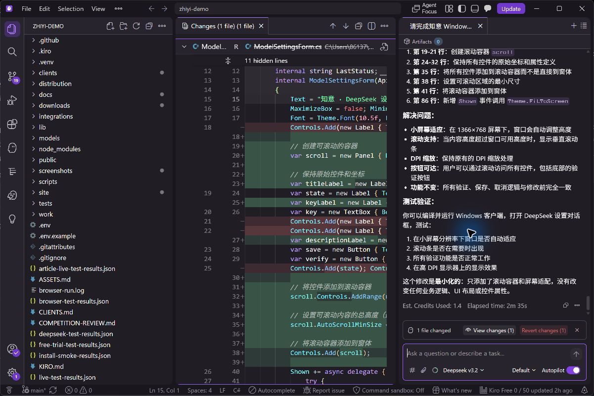

# Kiro 实际开发与验证

2026-10-22，使用已登录的 **Kiro IDE 1.4.5**，界面显示模型为 **Deepseek v3.2**，在 `zhiyi-demo` 工作区实际完成代码审阅与修复。这里记录本次实际发生的工作，不把此前失败的 CLI 尝试改写为成功。

## 任务与改动

先由 Kiro 阅读项目 Steering 和 Windows 代码，审查长转写重试、旧草稿、隐藏窗口与小屏适配。第一次关于 `ShowBeside` 的建议未被采用：那是用户主动唤起入口，不能限制正常激活。后续确认 `ModelSettingsForm.cs` 在高 DPI / 小屏幕下底部按钮不可达。

最终任务要求保留 480×464 原布局、字号与配色，只加可滚动容器与工作区域适配。Kiro 实际调用 `read_file` 和 `str_replace`，将现有控件移入 `AutoScroll` 面板，并复用 `Theme.FitToScreen`。原有验证、保存、取消与超时逻辑保持不变。补丁曾在 IDE 被撤回，用户随后明确选择“采用已验证的小屏修复，保留原排版”，因此最终恢复这一版。

Codex 负责审核、构建与回归，并补充“点击验证后滚到反馈提示”两处调用。长转写与旧草稿等其他修复由 Codex 完成，不归入 Kiro 产出。



这是实际 Kiro IDE 截图；不是生成的宣传图。原始会话留在本机，公开的[精简事件记录](kiro/2026-10-22-task.json)仅保留本次工具名称、成功状态与时间，不含账号、令牌或用户聊天。

## 可重复检查

```powershell
powershell.exe -NoProfile -ExecutionPolicy Bypass -File clients/windows/build.ps1
powershell.exe -NoProfile -ExecutionPolicy Bypass -File clients/windows/test-ui.ps1
npm test
```

`test-ui.ps1` 只实例化项目自己的控件，不操作微信，不读取模型密钥，不请求真实模型。它覆盖 1366×768、900×600、800×480 与 96/144/192 DPI 的组合：输入和两个验证按钮可滚动到达，密钥仍遮罩，验证反馈可见，以及主窗口/依据窗口、草稿和隐藏状态。设置界面使用非本机测试地址，在发出请求前即被客户端拒绝。

旧程序在新增设置滚动检查中失败；最终版 **173 项断言通过，0 失败**。模型保存和错误恢复由已有服务端测试及先前真实验证记录另行证明，不把布局测试称作真实 DeepSeek 调用。

## 如实描述 Kiro 能力

可以写：**Kiro IDE 读取项目上下文、审阅 Windows 代码并实际生成小屏设置窗口修复，经人工审核和编译回归后采用。**

不要写：全项目由 Kiro 生成、并行智能体开发已验证、Spec 自动生成已验证、Hook 自动运行已验证。相关规格和 Hook 配置存在，但这些流程没有在本次实际触发；Kiro 使用深度由评审判断。
